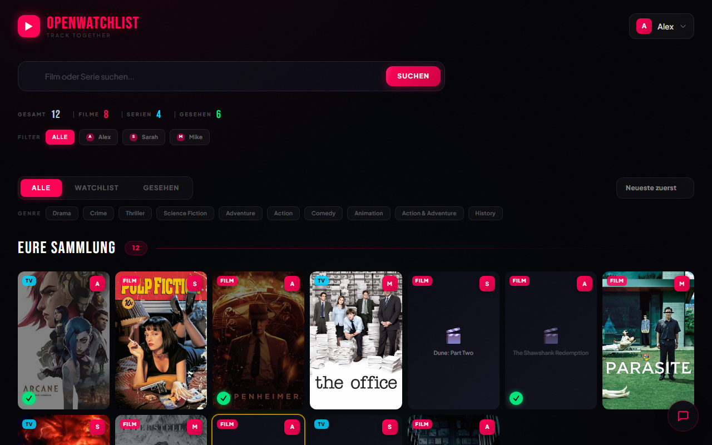
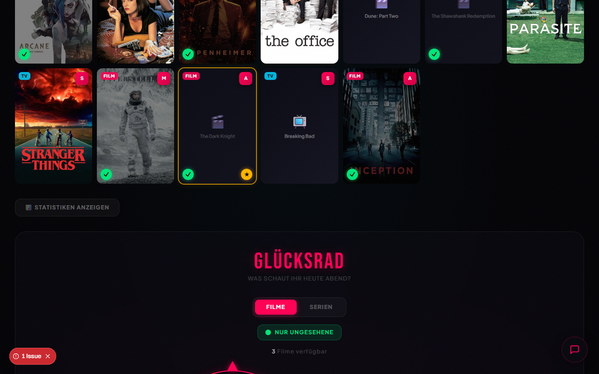
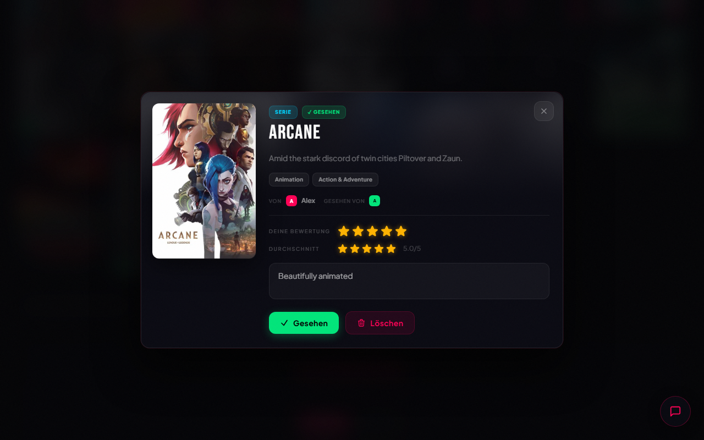
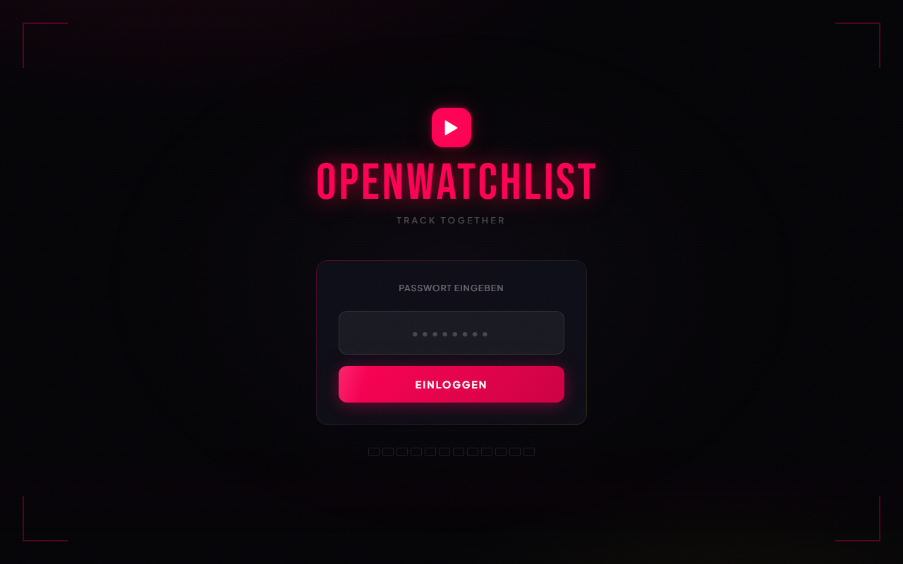

<div align="center">

# openWatchlist

**Open-source movie & TV show watchlist for groups. Track, rate, and discover together.**

Self-hosted. Password-protected. Open source.

[](https://github.com/erdinc61/openWatchlist/stargazers)
[](LICENSE)
[](https://github.com/erdinc61/openWatchlist/commits/master)

</div>

---

<div align="center">

</div>

## Why openWatchlist?

Most watchlist apps are single-user or locked behind subscriptions. openWatchlist gives your friend group a shared space to:

- **Add movies & TV shows** — search TMDB or add manually
- **Track who watched what** — per-profile seen/unseen state with personal ratings
- **Rate & review together** — star ratings, notes, average scores
- **Chat in real-time** — built-in group chat with presence indicators
- **Spin the wheel** — can't decide? Let the lucky wheel pick for you
- **Discover** — sort by rating, genre, date; filter by watchlist/watched; see streaming providers

---

## Features

### Movie Grid & Profiles

<div align="center">

</div>

<br>

- **Multi-profile system** — each member gets their own profile with avatar
- **TMDB integration** — poster, overview, genres, and streaming providers auto-filled
- **Lucky wheel** — random movie picker from your watchlist
- **Sort & filter** — by date, title, rating, genre, watched/unwatched

### Movie Details & Ratings

<div align="center">

</div>

<br>

- **Star ratings & notes** — rate 1-5 stars, add personal notes per movie
- **Per-user tracking** — see who watched what and their individual ratings
- **Analytics dashboard** — genre breakdown, rating distribution, watch stats

### Login

<div align="center">

</div>

<br>

- **Password-protected** — simple shared password auth
- **Dark cinematic UI** — film-noir inspired design with smooth animations
- **Real-time chat** — group chat with online/offline presence

---

## Quick Start

```bash
git clone https://github.com/erdinc61/openWatchlist.git
cd openWatchlist
cp .env.example .env    # edit DATABASE_URL if needed
npm install
npx prisma db push
npm run dev
```

Open `http://localhost:3000`, enter the password, create a profile, done.

---

## Tech Stack

| Layer | Technology |
|---|---|
| Framework | [Next.js 15](https://nextjs.org) (App Router, Turbopack) |
| Database | [SQLite](https://sqlite.org) via [Prisma ORM](https://prisma.io) |
| Styling | [Tailwind CSS v4](https://tailwindcss.com) |
| Movie Data | [TMDB API](https://www.themoviedb.org/documentation/api) |
| Language | [TypeScript](https://www.typescriptlang.org) |

---

## Contributing

Contributions are welcome! Feel free to open issues and pull requests.

1. Fork the repo
2. Create a branch (`git checkout -b feat/your-feature`)
3. Commit your changes (`git commit -m "feat: add something"`)
4. Push and open a PR

---

## License

MIT — see [LICENSE](LICENSE) for details.
